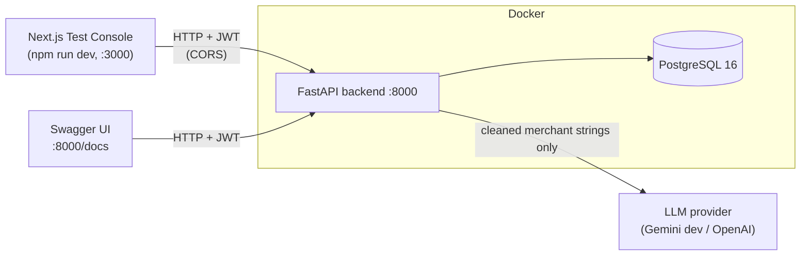
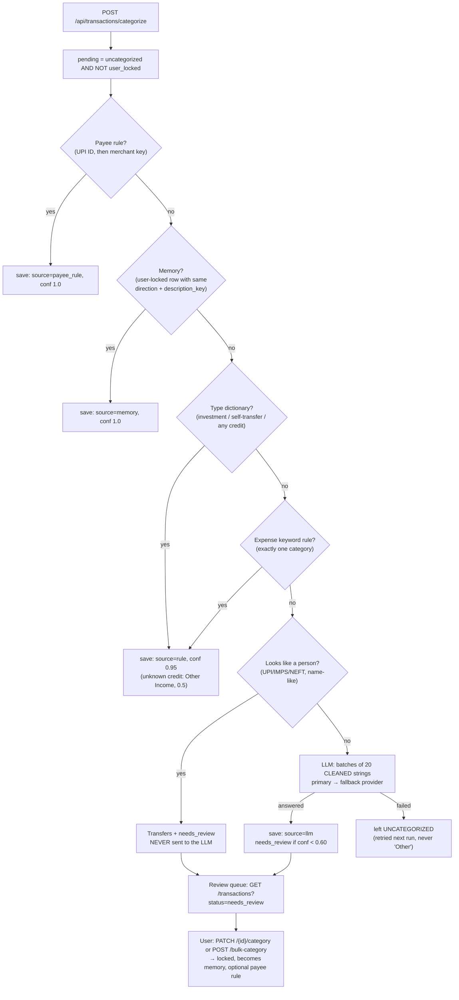

# Architecture

## 1. The big picture

The system is a FastAPI backend with a PostgreSQL database, running in Docker, plus a Next.js
frontend run on the host. Phase 3B delivers the **Expense Intelligence Agent**: it reads bank
statements, works out what kind of money movement each line is (expense, income, investment,
transfer), assigns a category, and learns from the user's corrections.



## 2. Layers (each layer only calls the one below it)

```
api/routes/   HTTP only: parse the request, call ONE service function, return the response
   │
services/     business logic: import, enrich, categorize, override, summarize
   │      └──► agents/   LLM reasoning only (prompt, batching, retries); no DB, no HTTP
   │                └──► llm/   provider abstraction; the ONLY place a vendor SDK is imported
models/ + db/ SQLAlchemy tables and the session
core/         config, security, constants shared by everyone (categories, txn types, dictionary)
schemas/      Pydantic request/response shapes (the API contract)
```

Why it matters: a route never contains logic, so the same logic can be called from a test,
the evaluation harness or (Phase 9) a Celery task. The agent never touches the database, so it
can be tested with a fake LLM and swapped without touching storage.

**Security rule:** `user_id` always comes from the verified JWT (`api/deps.py:get_current_user`),
never from the request body, and every query on user data filters by `user_id`. Someone else's
id therefore looks exactly like a missing id (404), which reveals nothing.

## 3. Folder map (`backend/`)

| Path | Contents |
|---|---|
| `app/main.py` | Creates the app, CORS middleware, registers routers, `/health` |
| `app/api/deps.py` | `get_current_user` (JWT → `User`) |
| `app/api/routes/` | `auth`, `statements`, `transactions`, `payee_rules`, `categories` |
| `app/services/` | All business logic (see the module pages) |
| `app/services/statement_parsers/` | `base.py` (interface), `csv_parser`, `xlsx_parser`, `pdf_parser`, `tabular.py` (shared) |
| `app/agents/expense_categorizer.py` | The LLM layer of the agent |
| `app/llm/` | `base.py`, `factory.py`, `gemini_provider.py`, `openai_provider.py` |
| `app/core/` | `config.py`, `security.py`, `categories.py`, `transaction_types.py`, `merchant_dictionary.py`, `money.py`, `logging_config.py` |
| `app/models/`, `app/schemas/` | Tables and API shapes |
| `migrations/` | Alembic: `0001_baseline`, `0002_statement_ingestion_and_overrides` |
| `evaluation/` | Research harness, labeled dataset, `results/` (gitignored) |
| `scripts/make_synthetic_statements.py` | Generates the synthetic PDF/XLSX/CSV fixtures (dev only) |
| `tests/` | 223 unit and HTTP tests (in-memory SQLite, fake LLM) |

## 4. Flow 1: upload a statement

```mermaid
sequenceDiagram
    actor U as User
    participant R as routes/statements.py
    participant S as statement_import_service
    participant P as Parser (CSV / XLSX / PDF)
    participant T as tabular.assemble_rows
    participant E as transaction_enrichment
    participant DB as PostgreSQL

    U->>R: POST /api/statements/upload (file, password?)
    R->>R: size check (≤ 10 MB)
    R->>S: import_statement(user_id from JWT, bytes, password)
    S->>P: get_parser(extension).parse(bytes, password)
    P->>T: grid of cells
    T-->>S: ParseResult(rows, invalid, layout, opening balance)
    S->>S: check_balances (prev − debit + credit = balance ± 0.01)
    S->>DB: load existing rows in the date range (dedupe keys)
    S->>DB: INSERT import_batches
    loop each new row
        S->>E: enrich_transaction (channel, payee_key, txn_type; local)
    end
    S->>DB: INSERT transactions, COMMIT
    S-->>U: import summary (counts, by_txn_type, balance check, next_step)
```

Rows are saved **uncategorized**. Categorization is a separate call, so a large upload never
waits for the LLM and a failed LLM call never loses imported data.

## 5. Flow 2: categorize, then review



## 6. Privacy boundary

Everything left of the LLM arrow in section 1 is local. Specifically:

- Parsing (including PDF passwords) is 100% local. Passwords are never stored or logged.
- The LLM receives only `description_key` (lowercased, no digits, no UPI handles, no rail words),
  the median amount of that group and how many rows share it. It never sees raw narrations, UPI IDs,
  reference numbers, balances, account numbers, or person-like payees.
- Few-shot examples sent to the LLM are the user's past corrections, cleaned the same way, with
  person-like payees removed.
- Logs contain counts and ids, never narrations.
- **Measured limitation:** the person guard is a heuristic. In the latest offline evaluation it had
  recall 0.857, and 1 person-like string out of the labeled set still reached the LLM stage (see
  [modules/evaluation.md](modules/evaluation.md)). Use synthetic data with the free Gemini tier.

## 7. Key design decisions

| Decision | Why |
|---|---|
| Cheapest-first priority (lock → payee rule → memory → rules → guard → LLM) | Fewer LLM calls (0.88 per 100 rows offline), deterministic and explainable for most rows, and the rule layer doubles as the research baseline |
| `txn_type` separate from `category` | A SIP is not spending. Budgets (Phase 4) count only `txn_type='expense'` |
| Strategy pattern for parsers + one shared pipeline | A new format = one class; dedupe, balance check and enrichment are never duplicated |
| `amount` is `Numeric(14,2)`, Python `Decimal` | Floats drift by paise when summed |
| Alembic migrations; app no longer calls `create_all` | Schema changes without wiping the DB; the drift test catches a forgotten migration |
| `agent_category` kept when the user overrides | Measures override rate (feedback metric for the paper) |
| No `status` column; status is a computed filter | One less column to keep consistent |
| Provider abstraction + fallback chain | Swap Gemini/OpenAI by config; a quota error on one provider does not stop the run |

## 8. Known gaps (carry into later phases)

- `LLM_PROVIDER` currently supports `gemini` and `openai` only. A HuggingFace/Llama provider is part
  of the approved stack but not yet in `llm/factory.py:PROVIDER_REGISTRY`.
- Categorization is synchronous (a large batch with many LLM calls blocks the request). Phase 9 / optional S9 moves it to Celery.
- Investment **returns** cannot be computed from a bank statement; only net cash flow (Phase 6).
- Scanned PDFs are rejected (no OCR).
- The frontend Test Console is only partly built (see [modules/frontend-console.md](modules/frontend-console.md)).
