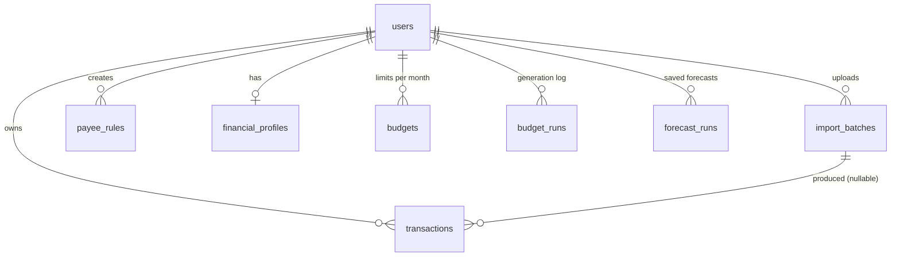

# Database

PostgreSQL 16 in Docker (`docker-compose.yml`, service `db`). Tables are defined in
`backend/app/models/` and created/changed **only** by Alembic migrations in `backend/migrations/versions/`.

## Migrations

| Revision | File | What it does |
|---|---|---|
| `0001` | `0001_baseline.py` | The schema as it was at the end of Phase 3B v2 (`users`, `transactions`) |
| `0002` | `0002_statement_ingestion_and_overrides.py` | v3: new `transactions` columns, `amount` Float → `Numeric(14,2)`, new tables `import_batches` and `payee_rules`. Existing rows survive: every new column is nullable or has a server default |
| `0003` | `0003_budget_planning.py` | Phase 4: new tables `financial_profiles`, `budgets`, `budget_runs` (no change to existing tables) |
| `0004` | `0004_forecast_runs.py` | Phase 5: new table `forecast_runs` (no change to existing tables) |

The backend container runs `alembic upgrade head` before starting uvicorn (`backend/Dockerfile`),
so a normal `docker compose up --build` always brings the schema up to date. **You no longer need
`docker compose down -v` after a schema change.**

Adding a column, step by step:

1. Change the model in `app/models/`.
2. Create a revision: `docker compose exec backend alembic revision -m "short description"`, then write
   `upgrade()` and `downgrade()` by hand (or review an `--autogenerate` draft line by line).
3. Restart the backend (or `docker compose exec backend alembic upgrade head`).
4. Run the tests. `tests/test_migrations.py` fails if the models and the migrations disagree ("drift").

Common mistakes: importing app code (for example the type detector) inside a migration. It breaks
when that code changes later, so migrations use plain SQL only. Another: forgetting `downgrade()`.

## Entity relationships



## `users`

| Column | Type | Notes |
|---|---|---|
| `id` | int PK | indexed |
| `email` | varchar(255) | unique, indexed |
| `full_name` | varchar(255) | |
| `hashed_password` | varchar(255) | bcrypt hash, never the password |
| `is_active` | bool | default true |
| `created_at` | timestamptz | server default `now()` |

## `transactions`

One row = one statement line (debit or credit) of one user.

| Column | Type | Notes |
|---|---|---|
| `id` | int PK | |
| `user_id` | FK users | indexed; every query filters on it |
| `description` | varchar(500) | raw narration as imported |
| `amount` | numeric(14,2) | always **positive**; `direction` gives the sign |
| `direction` | varchar(6) | `debit` (out) / `credit` (in); default `debit` |
| `txn_type` | varchar(20) null | `expense` / `income` / `investment_out` / `investment_in` / `transfer`. NULL on pre-v3 rows until the next categorize run backfills it |
| `investment_subtype` | varchar(20) null | `sip` / `lump_sum` / `wallet_topup` (only for `investment_out`) |
| `channel` | varchar(10) null | `upi` / `neft` / `imps` / `nach` / `card` / `atm` / `cheque` / `other` |
| `payee_key` | varchar(200) null | UPI ID (lowercase) if present, else `description_key` |
| `description_key` | varchar(200) null | normalized narration (indexed); used by memory, grouping and the LLM |
| `balance` | numeric(14,2) null | running balance printed on the statement |
| `balance_ok` | bool null | balance check result; NULL = could not be checked |
| `category` | varchar(100) null | NULL = uncategorized |
| `category_confidence` | float null | 0–1 |
| `category_reasoning` | varchar(1000) null | shown as the "why" in the UI |
| `category_source` | varchar(20) null | `payee_rule` / `memory` / `rule` / `llm` / `user` |
| `agent_category` | varchar(100) null | the agent's **first** suggestion; kept after a user override (override-rate metric) |
| `user_locked` | bool | true once the user set the category; no agent run touches it |
| `needs_review` | bool | confidence below `CATEGORIZER_REVIEW_THRESHOLD` (0.60), or person-guarded |
| `import_batch_id` | FK import_batches null | indexed; NULL for manual entries |
| `transaction_date` | timestamptz | |
| `created_at` | timestamptz | |

Indexes: `user_id`, `description_key`, `import_batch_id`, and the composite `(user_id, payee_key)`
used by "same payee" lookups.

### Status is computed, not stored

`GET /api/transactions?status=...` maps to:

| status | condition |
|---|---|
| `uncategorized` | `category IS NULL` |
| `needs_review` | `needs_review AND NOT user_locked` (sorted least confident first) |
| `categorized` | `category IS NOT NULL AND NOT needs_review AND NOT user_locked` |
| `locked` | `user_locked` |

## `import_batches`

One row per uploaded file (also feeds the parsing metrics).

| Column | Type | Notes |
|---|---|---|
| `id`, `user_id` | | `user_id` indexed |
| `filename` | varchar(255) | |
| `source_type` | varchar(10) | `csv` / `xlsx` / `pdf` |
| `layout` | varchar(30) null | `hdfc_like` / `sbi_like` / `generic` (label for metrics only) |
| `rows_total`, `rows_imported`, `rows_duplicate`, `rows_invalid` | int | |
| `balance_checked` | bool | the file had a balance column we could verify |
| `balance_mismatches` | int | |
| `created_at` | timestamptz | |

## `payee_rules`

Opt-in "remember this payee" rules.

| Column | Type | Notes |
|---|---|---|
| `id`, `user_id` | | `user_id` indexed |
| `match_type` | varchar(20) | `upi_id` (preferred) or `merchant_key` |
| `match_value` | varchar(200) | the UPI ID or normalized merchant key |
| `category` | varchar(100) | |
| `created_at` | timestamptz | |

Constraint: `UNIQUE(user_id, match_type, match_value)`, so remembering the same payee again
**updates** the rule instead of adding a second one.

## `financial_profiles`

Phase 4. The two numbers the budget planner needs from the user.

| Column | Type | Notes |
|---|---|---|
| `id`, `user_id` | | `UNIQUE(user_id)` (`uq_financial_profiles_user_id`): one profile per user |
| `monthly_income` | numeric(14,2) | > 0 (validated by the API) |
| `savings_target_pct` | numeric(5,2) | server default 20 (= 20% of income) |
| `updated_at` | timestamptz | refreshed on every update |

## `budgets`

Phase 4. One monthly limit per category.

| Column | Type | Notes |
|---|---|---|
| `id`, `user_id` | | `user_id` indexed (`ix_budgets_user_id`) |
| `month` | varchar(7) | `YYYY-MM` |
| `category` | varchar(100) | an expense category (never `Investments & Savings`) |
| `limit_amount` | numeric(14,2) | the limit in force (agent's or user's) |
| `agent_limit_amount` | numeric(14,2) | the planner's original number; a user override never changes it (override metric, reset) |
| `source` | varchar(10) | `agent` (refreshed on regeneration) or `user` (never touched by the planner); server default `agent` |
| `reasoning` | varchar(1000) | one sentence (LLM text that passed the guard, or the template) |
| `created_at` | timestamptz | |

Constraint: `UNIQUE(user_id, month, category)` (`uq_budgets_user_month_category`), so regeneration
**updates** a row instead of duplicating it.

## `budget_runs`

Phase 4 research log: one row per generation. Never shown to the user as advice.

| Column | Type | Notes |
|---|---|---|
| `id`, `user_id` | | `user_id` indexed (`ix_budget_runs_user_id`) |
| `month` | varchar(7) | |
| `method` | varchar(10) | `history` or `baseline` |
| `spendable`, `shortfall` | numeric(14,2) | |
| `feasible` | bool | false when essentials alone exceed spendable income |
| `months_used` | int | months of history behind the plan |
| `llm_used` | bool | an LLM answered with usable JSON |
| `explanation_faithful` | bool, nullable | true = all LLM text passed the guard; false = some was replaced; NULL = no LLM text |
| `created_at` | timestamptz | |

## `forecast_runs`

Phase 5: one row per generated forecast (shown again by `/api/forecast/latest`, `/history`, `/runs/{id}`).
Every money column is `numeric(14,2)`.

| Column | Type | Notes |
|---|---|---|
| `id`, `user_id` | | `user_id` indexed (`ix_forecast_runs_user_id`) |
| `as_of` | date | the "today" of the forecast (injected, so runs are reproducible) |
| `horizon_days` | int | 30, 60 or 90 |
| `model_name` | varchar(40) | model of the variable spending (`naive_last`, `moving_average_3`, `exp_smoothing`, `seasonal_naive_12`) |
| `history_months` | int | complete months of history used |
| `low_confidence` | bool | too little history for a backtest choice or a residual interval |
| `opening_balance` | numeric | |
| `opening_balance_source` | varchar(10) | `request` or `statement` |
| `opening_balance_date` | date, nullable | date of the statement row the balance came from |
| `income_source` | varchar(10) | `recurring`, `profile` or `none` |
| `expected_income`, `expected_fixed_expenses`, `expected_investments`, `net_cashflow` | numeric | totals over the horizon |
| `expected_variable_expenses` (+ `_lower`, `_upper`) | numeric | point and 80% interval |
| `projected_end_balance` (+ `_lower`, `_upper`) | numeric | balance on the last day, with its band |
| `cash_crunch_date` | date, nullable | first day the LOWER balance band is below 0 |
| `summary` | text | the explanation shown (LLM text that passed the guard, or the template) |
| `llm_used` | bool | |
| `explanation_faithful` | bool, nullable | true = passed the guard; false = invented a number (template shown); NULL = no LLM text |
| `trajectory` | json | `[{date, balance, lower, upper}]`, one per day |
| `recurring_items`, `budget_warnings`, `model_scores` | json | what the forecast used and found (see the API) |
| `created_at` | timestamptz | |

## Inspecting the data

```powershell
docker compose exec db psql -U finance_user -d finance_db
```
```sql
\dt
SELECT txn_type, category_source, count(*) FROM transactions GROUP BY 1, 2 ORDER BY 1, 2;
SELECT version_num FROM alembic_version;   -- should be 0004
SELECT method, feasible, llm_used, explanation_faithful, count(*) FROM budget_runs GROUP BY 1, 2, 3, 4;
SELECT horizon_days, model_name, low_confidence, count(*) FROM forecast_runs GROUP BY 1, 2, 3;
```
