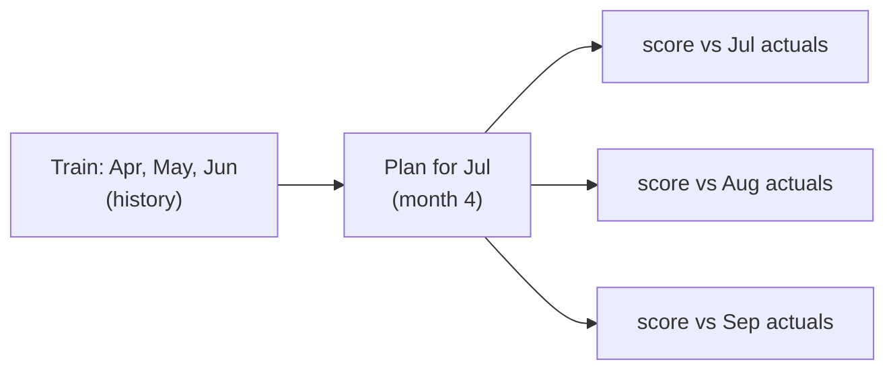

# Module: Budget evaluation (research, Phase 4)

**Files:** `backend/scripts/make_synthetic_history.py`, `backend/evaluation/synthetic_budget_history.csv`,
`backend/evaluation/evaluate_budget.py`, `backend/evaluation/metrics.py` (budget section),
`backend/evaluation/budget_metrics.csv` + `budget_metrics.md` (committed results),
`backend/tests/test_synthetic_history.py`, `backend/tests/test_budget_evaluation.py`.

## Why it exists

To answer, with numbers, "are the agent's limits better than a fixed rule?", and to justify each design
choice (trim, lookback, excluding investments, the guard) with an ablation. Like the categorizer evaluation,
it runs the **real** services (`suggest_income`, `generate_budget`, `budget_status`, `override_budget`) on a
throwaway in-memory SQLite database, so the numbers describe what the app actually does.

## Data: 3 synthetic personas, 6 months

`make_synthetic_history.py` generates 693 transactions (April–September 2026) with a **fixed seed (42)**
and its own `random.Random`, so every run is byte-identical. Nothing is real: merchants are `SYNTH ...`,
person-to-person payees are `UPI/P2P/PAYEE-0001`.

| Persona | Income | Savings target | Spending pattern |
|---|---|---|---|
| frugal | salary ₹55,000 | 25% | ~₹26k/month, ±5% noise, well inside its means |
| overspender | salary ₹70,000 | 20% | ~₹68k/month, discretionary far above what fits → limits get scaled down |
| irregular | freelance ₹35k–92k | 15% | ±25–50% noise plus one-offs: trip (May), medical bill (June), festival shopping (Aug), trip (Sep) |

Every persona also has rows that **must not** count as spending: a monthly SIP, broker top-ups or
self-transfers, a redemption, a refund and interest. Categories are ground truth ("oracle labels"),
which isolates the planner from categorizer mistakes.

## Protocol (time-based split, never random)



- The July plan is built from April–June only and scored against the actual spending of July, August and
  September (per month, and as a mean). A random split would let the plan see the future.
- Profile income = the P5 income suggestion over the training window (refunds excluded), kept **fixed**
  across ablations so only the planner changes.

## Methods and ablations

| Name | What it is |
|---|---|
| **B0** baseline | `build_baseline_plan`: fixed weights of spendable income (50/30/20-style) |
| **B1** default | `generate_budget`: history average, essentials kept, discretionary trimmed 10%, templates |
| **B2** llm | B1 + one LLM call to explain. Same numbers, so it isolates the explanation (`--llm real` only) |
| trim=0.00/0.05/0.10/0.20 | B1 with a different discretionary trim |
| lookback=1/2/3 | B1 with a different history window. **6 is left out**: it would read the test months |
| investments_as_spending | Naive planner: every categorized debit (SIPs, top-ups, self-transfers) counts as spending |
| simulated_overrides | An oracle user replaces every July limit overshot by >20% with July's actual |

## Metrics (`evaluation/metrics.py`)

| Metric | Formula | Read it as |
|---|---|---|
| MAE | mean over categories of \|limit − actual\| (₹) | how far limits are from reality |
| MAPE | mean of \|limit − actual\| / actual, categories with actual = 0 skipped (count reported) | the same, relative |
| Adherence | share of categories with actual ≤ limit (unbudgeted spending = not adherent) | how often limits hold |
| Overspend | Σ max(0, actual − limit) (₹) | money spent above the plan |
| Unused limit | Σ max(0, limit − actual) (₹) | slack: budget that was never needed |
| Feasibility rate | share of plans with `feasible=true` | can the plan fit the income? |
| Budget distortion | (naive history − correct history) / correct history | error from counting investments as spending |
| Override rate / size | share of rows with `source='user'`; mean \|final − agent\| / agent | how much users disagree |
| Faithfulness | share of plans whose LLM text passed the guard; replaced texts / total texts | how often the LLM invents a number (guard off = this reaches the user) |
| LLM calls per plan | counted by the agent | cost (always ≤ 1 + fallback) |

## Results (offline, `--llm none`, seed 42)

| Persona | Method | MAE | MAPE | Adherence | Overspend | Unused limit |
|---|---|---|---|---|---|---|
| frugal | B0 baseline | ₹1,138 | 90.3% | 84.4% | ₹907 | ₹16,165 |
| frugal | B1 default | ₹79 | 6.0% | 22.2% | ₹673 | ₹39 |
| irregular | B0 baseline | ₹1,707 | 48.3% | 73.3% | ₹11,920 | ₹13,681 |
| irregular | B1 default | ₹1,649 | 21.6% | 63.6% | ₹9,990 | ₹8,154 |
| overspender | B0 baseline | ₹2,019 | 36.8% | 37.8% | ₹21,592 | ₹8,690 |
| overspender | B1 default | ₹1,162 | 25.5% | 25.0% | ₹13,424 | ₹522 |

Ablations (mean over the 3 personas):

| Configuration | MAE | MAPE | Adherence | Overspend | Unused limit |
|---|---|---|---|---|---|
| B0 baseline | ₹1,621 | 58.4% | 65.2% | ₹11,473 | ₹12,845 |
| B1 default (trim 10%, lookback 3) | ₹964 | 17.7% | 37.0% | ₹8,029 | ₹2,905 |
| trim 0% / 5% / 20% | ₹947 / ₹955 / ₹984 | 16.7% / 17.1% / 19.0% | 44.4% / 37.0% / 34.9% | | |
| lookback 1 / 2 | ₹1,143 / ₹1,033 | 20.0% / 17.3% | 36.2% / 34.9% | | |
| investments_as_spending | ₹1,069 | 20.3% | 39.7% | ₹8,897 | ₹3,307 |

Counting investments as spending inflates the history by **30.9% (frugal), 7.7% (irregular), 11.7%
(overspender)** and hands ₹7,200 / ₹3,300 / ₹1,400 of "spending limit" to a SIP. Simulated overrides:
0% (frugal), 18.2% (irregular), 58.3% (overspender). All plans were feasible. The full tables are in
`backend/evaluation/budget_metrics.md`; every number is in `budget_metrics.csv`.

### How to read these numbers

- **B1 beats B0 on every error measure** (MAE −40%, MAPE 58% → 18%, less overspend, far less slack).
- **B0's higher adherence is an artefact of loose limits.** It gives the frugal persona ₹16k a month it
  never spends. That is why adherence is always reported next to overspend and unused limit.
- **Trim is a trade-off:** a larger trim asks for more saving, so (with people who do not change their
  habits) adherence falls. This curve is the main figure for the paper.
- A 3-month lookback has the lowest error; 1 month overreacts to one noisy month.

## Limitations (state them in the paper)

1. Synthetic actuals **do not react to the budget**, so adherence measures how realistic the limits are,
   not whether a person complies. A user study (P8 frontend) is needed for behaviour change.
2. Oracle categories: real errors from the categorizer would add noise.
3. Every persona's plan is feasible; the infeasible path is covered only by unit tests.
4. The generator and the planner were written by the same team. The personas encode our assumptions.
5. MAE includes the **intended** trim, so a 0% error is not the goal. Compare methods, not absolute values.
6. Overrides are simulated by a rule, not by people.

## Run it

```powershell
docker compose exec backend python -m scripts.make_synthetic_history          # regenerate the data (same bytes)
docker compose exec backend python -m evaluation.evaluate_budget              # offline: B0, B1, ablations
docker compose exec backend python -m evaluation.evaluate_budget --llm real   # + B2 (3 LLM calls, SYNTHETIC data)
```

Offline output overwrites the committed `budget_metrics.csv` / `.md`. A rerun produces no git diff,
because there are no timestamps and values are rounded to 4 decimals. `--llm real` writes to
`evaluation/results/budget_metrics_<timestamp>.csv` (gitignored), so the committed file is always the offline one.

CSV format (long): `llm_mode, method, config, persona, eval_month, category, metric, value`.
`eval_month` is `plan` (plan-level facts), a test month, or `mean`. Per-category rows (`category` set) exist
for B0, B1 default and B2.

## Next research steps

- Run `--llm real` and report B2 faithfulness (the fake-LLM test already shows the guard catches 3/3 invented amounts).
- Phase 5 (done): the forecast evaluation uses the 3-month average as baseline B1 on a 24-month panel; see [forecast-evaluation.md](forecast-evaluation.md).
- Optional survey: teammates rate B1 template vs B2 LLM explanations (1–5 helpfulness).
