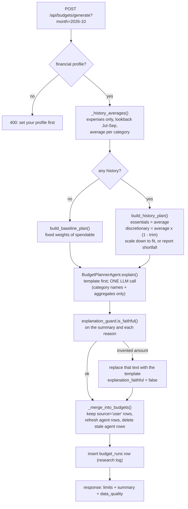

# Module: Budget Planning Agent (Phase 4)

**Files:** `services/budget_service.py`, `services/budget_calculator.py`, `agents/budget_planner.py`,
`agents/explanation_guard.py`, `core/month_utils.py`, `core/money.py`, `api/routes/profile.py`,
`api/routes/budgets.py`, `schemas/budget.py`, `models/budget.py`, `models/financial_profile.py`,
`backend/migrations/versions/0003_budget_planning.py`.
Design source: [../phase4-spec.md](../phase4-spec.md). Evaluation: [budget-evaluation.md](budget-evaluation.md).

## Purpose

The user gives two numbers: monthly income and a savings target (% of income). The agent reads the
last N months of **categorized expenses** and produces a spending limit per category for a month,
each with a one-sentence reason. A status endpoint then compares the month's real spending with
those limits (ok / warning / exceeded / unbudgeted).

It builds directly on Phase 3B v3: without `txn_type`, a SIP or a self-transfer would look like
spending and the budget would be wrong (see the "investments counted as spending" ablation).

## Architecture: who does what

| Layer | File | Responsibility |
|---|---|---|
| Route | `api/routes/profile.py`, `api/routes/budgets.py` | HTTP only. `month` validated as `^\d{4}-(0[1-9]\|1[0-2])$` (422 otherwise) |
| Service | `services/budget_service.py` | Reads history from the DB, calls the calculator and the agent, merges limits, logs `budget_runs`, status |
| Rules engine | `services/budget_calculator.py` | **All the maths.** Pure `Decimal` functions, no DB, no LLM |
| Agent | `agents/budget_planner.py` | Explains a finished plan in words. **One** LLM call per plan, template fallback |
| Guard | `agents/explanation_guard.py` | Rejects LLM text that mentions a rupee amount that is not in the plan |
| Helpers | `core/month_utils.py`, `core/money.py` | `'YYYY-MM'` → UTC range, lookback window; exact 2-decimal money |

The key design rule: **Python computes, the LLM only explains.** An LLM cannot guarantee that limits
add up to the spendable income; a calculator can, and it can be unit-tested.

## Flow: generate a plan



### Status flow
`GET /api/budgets/status?month=` sums the month's expenses per category (same expense rule), pairs
them with that month's limits and labels each one:
`ok` (< 80% of the limit) · `warning` (≥ 80%) · `exceeded` (> 100%) · `unbudgeted` (spending with no limit).
It also reports `invested_this_month` (investment_out, which is **saved, not spent**) and the savings target.

## Input

| Input | Where it comes from |
|---|---|
| Monthly income, savings target % | `financial_profiles` (PUT `/api/profile/financial`; the suggestion endpoint can propose the income) |
| Spending history | `transactions` of the N full months **before** the target month, where `txn_type='expense'` (or untyped debits from before v3), categorized with an expense category |
| Tuning knobs | `.env` / `core/config.py` (below) |

What is **not** spending: `investment_out` (SIPs, broker top-ups), `investment_in` (redemptions),
`income`, `transfer` (between your own accounts). `Investments & Savings` is never given a limit; the
savings target covers it.

## Output

`POST /api/budgets/generate?month=2026-10` with income ₹50,000, target 20%, and three months of history
(rent ₹15,000, groceries ₹6,000, food ₹5,000 per month):

```json
{
  "month": "2026-10", "method": "history",
  "monthly_income": 50000.0, "savings_target_amount": 10000.0, "spendable_income": 40000.0,
  "feasible": true, "shortfall": 0.0,
  "summary": "Based on 3 months of spending, essentials keep their average and discretionary categories are trimmed 10% to fit your ₹40,000 spendable income after saving ₹10,000 (20% of your ₹50,000 income).",
  "llm_used": false, "explanation_faithful": null,
  "data_quality": {"months_used": 3, "uncategorized_count": 0, "needs_review_count": 0, "transfers_total": 0.0},
  "budgets": [
    {"id": 1, "month": "2026-10", "category": "Housing & Rent", "limit_amount": 15000.0, "agent_limit_amount": 15000.0,
     "source": "agent", "reasoning": "Essential spending, so it stays at your monthly average of ₹15,000."},
    {"id": 3, "month": "2026-10", "category": "Food & Dining", "limit_amount": 4500.0, "agent_limit_amount": 4500.0,
     "source": "agent", "reasoning": "Your average is ₹5,000; trimmed 10% to ₹4,500."}
  ]
}
```
(`Groceries` omitted for space.) Field-by-field reference: [../api.md](../api.md#budgets).

## The calculator rules (`budget_calculator.py`)

1. `spendable = income × (100 − savings%) / 100`, rounded **down** to the paisa.
2. **Essentials** (rent, groceries, utilities, transportation, healthcare, insurance, education) keep their average.
3. **Discretionary** categories (everything else, including `Transfers` = money sent to people) are cut by `BUDGET_DISCRETIONARY_TRIM`.
4. If the total is still above spendable, discretionary limits are **scaled down proportionally**.
5. If essentials alone exceed spendable: discretionary = 0, `feasible=false`, and the `shortfall` is reported honestly.
6. No history at all → **baseline plan** (fixed weights, `BASELINE_WEIGHTS`, sum exactly 1).
7. Every limit is rounded **down**, so the limits never add up to more than spendable.

Average per category = total in the window ÷ number of months that had **any** categorized expense, so a
one-off purchase is spread over the window instead of becoming a monthly limit.

## Overrides and regeneration

- `PUT /api/budgets/{id}` sets your own limit: `source='user'`. `agent_limit_amount` keeps the planner's number.
- `POST /api/budgets/{id}/reset` puts `agent_limit_amount` back and sets `source='agent'`.
- Regenerating the same month **never** changes `source='user'` rows; agent rows are refreshed;
  agent rows for categories no longer in the plan are deleted.
- Override rate and size (research metrics) come from `source` and `agent_limit_amount`.

## Income suggestion

`GET /api/profile/financial/suggestion?month=` averages income credits (salary, interest, dividends,
other income; **refunds excluded** because they are money returned, not earned) over the lookback months.
The divisor is the number of months in the window that have **any** transaction: a month with statements
but no salary counts as ₹0, and a month never imported does not lower the average. Read-only; returns
`suggested_monthly_income: null` with a message when there is no income.

## LLM, guard and privacy

- **One** call per plan (fallback provider only if the first fails). No API key → templates, and the
  plan still works (`llm_used=false`).
- The LLM receives only: month, method, income, savings target, spendable, feasible/shortfall, months
  of history, trim %, and per category `{category, limit, avg_monthly_spend, essential}`.
  **Never** descriptions, payees, UPI IDs or account details (tested in `test_budget_service.py`).
- The guard extracts every `₹ / Rs. / INR` amount from the LLM text and checks it against the allowed
  numbers (limits, averages, income, savings, spendable, shortfall, 0) within `BUDGET_GUARD_TOLERANCE` rupees.
  A failing sentence is replaced by the template; `budget_runs.explanation_faithful=false` records it.
- Known limit: the guard only checks numbers **with** a currency marker. "Save 5000 a month" would
  pass. That is a documented gap, not a silent one.

## Tables (migration `0003`)

`financial_profiles` (one per user), `budgets` (UNIQUE user+month+category, `limit_amount`,
`agent_limit_amount`, `source`, `reasoning`), `budget_runs` (research log). Columns: [../database.md](../database.md#financial_profiles).

## Configuration (`core/config.py`, override in `.env`)

| Setting | Default | Meaning |
|---|---|---|
| `BUDGET_LOOKBACK_MONTHS` | 3 | Full months of history before the target month |
| `BUDGET_DISCRETIONARY_TRIM` | 0.10 | Cut on discretionary averages (essentials are never cut) |
| `BUDGET_WARNING_THRESHOLD` | 0.80 | Status turns `warning` at this share of the limit |
| `BUDGET_GUARD_TOLERANCE` | 1.0 | Rupees of rounding the LLM may use |
| `BUDGET_USE_LLM_EXPLANATIONS` | true | `false` = templates only (ablation B1) |

## Testing

| File | Covers |
|---|---|
| `test_budget_calculator.py` | baseline weights sum to 1, spendable, trim, scale-down, infeasible, never above spendable, savings never budgeted |
| `test_month_utils.py` | month bounds, December rollover, lookback window, bad months |
| `test_explanation_guard.py` | amount extraction (₹ / Rs. / INR), tolerance, invented amounts |
| `test_budget_planner.py` | templates, JSON parsing, guard replacement, provider fallback, no LLM → templates |
| `test_budget_service.py` | expenses only, window, user isolation, overrides survive regeneration, reset, data quality, LLM down/unfaithful, privacy, status, income suggestion |
| `test_budgets_api.py` | every endpoint over HTTP, 404 on another user's budget, month and body validation (422) |

Manual check in Swagger: PUT a profile → `GET /financial/suggestion` → `POST /generate` → `PUT` one
limit → regenerate (your limit is unchanged) → `POST /{id}/reset` → `GET /status`.

## Common beginner mistakes

- Letting the LLM compute or "adjust" numbers. It must only explain finished numbers.
- Counting every debit as spending (SIPs and self-transfers would inflate the budget by 8–31% in our data).
- Using `float` for money: limits drift by paise and can add up to more than the income.
- Including the target month in its own history (data leakage; the window ends the day before).
- Overwriting a user's override on regeneration, which destroys trust and the override metric.
- Rounding limits to the nearest paisa instead of **down**: the total can exceed spendable by a paisa.

## What it connects to next

- **P8 (frontend):** `/budgets` page: profile form with the suggestion button, generate, edit/reset, status bars.
- **Phase 5 (Forecast):** replaces the simple average with a forecast model; the B1 history-average is its baseline.
- **Phase 9 (Celery):** monthly automatic regeneration. **Phase 10 (Coach):** uses `status` to nudge the user.
