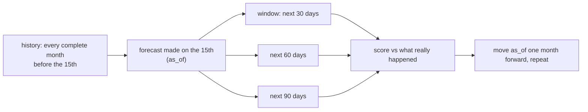

# Module: Forecast evaluation (research, Phase 5)

**Files:** `backend/scripts/make_synthetic_panel.py`, `backend/evaluation/evaluate_forecast.py`,
`backend/evaluation/metrics.py` (forecast section), `backend/evaluation/forecast_metrics.csv` + `forecast_metrics.md`
(committed results), `backend/tests/test_synthetic_panel.py`, `backend/tests/test_forecast_evaluation.py`.

## Why it exists

The paper's Phase 5 question: *on short personal-finance histories, does a recurrence-aware decomposition with
per-user backtest model selection and honest intervals beat a single fixed model or a model without the
decomposition?* This harness answers it with numbers, and it already paid for itself. Its first run found
two weaknesses in the agent, which step F6.1 fixed (see "Before and after F6.1").

Like the budget evaluation it runs the **real** service (`generate_forecast`, including `prepare_history`,
recurrence detection, the statement opening balance and the profile income) on a throwaway in-memory SQLite DB.

## Data: a 24-month synthetic panel, 30 users, 4 personas

`make_synthetic_panel.py` (seed 42) writes 28,525 transactions, October 2024 – September 2026. Each user has its
own `random.Random(seed × 1000 + user number)`, so adding a user never changes the others, and the whole panel is
byte-identical on every run. SHA-256 of the CSV: `801ee5f4158e1688…` (printed by the script and in `forecast_metrics.md`).

| Persona | Users | Income | What makes it hard |
|---|---|---|---|
| steady | 8 | salary ₹45k–90k | little; a medium SIP, festival spikes |
| freelancer | 7 | 1–3 invoices a month, 0.35×–1.75× the mean, ~1 month in 12 with none | no salary to detect, lumpy income, dips below zero |
| high_spender | 8 | salary ₹60k–120k | car-loan EMI, spends about everything, lifestyle drift, dips below zero |
| saver | 7 | salary ₹50k–110k | large SIP, low spending |

Built-in effects: festival spikes in October/November (Shopping ×1.8–2.6), one salary hike in April 2026,
one hospital bill per user (15–40% of a month's income), slow spending drift, refunds, quarterly interest,
P2P transfers to `UPI/P2P/PAYEE-xxxx`. **Reactive own-account transfers** keep balances realistic: a month that
ends below a floor gets a top-up from savings on the 1st; a month above a ceiling sweeps the surplus out.
Ground truth columns: `balance` (running statement balance) and `recurring` (the scheduled salary, rent,
subscription, SIP and EMI rows). Freelancer months dip below zero 16% of the time and high-spender months 10%;
steady users and savers never do.

The panel CSV is **not committed** (it regenerates in 0.3 s). The script writes it to `evaluation/results/` (gitignored).

## Protocol: time-based rolling origin (never a random split)



- **Origins:** the 15th of every month with at least 6 complete months before it whose 90-day window still
  ends in the panel: 2025-04-15 … 2026-06-15, **15 origins**. The same origins are used for all three horizons.
- 30 users × 15 origins × 3 horizons = **1,350 forecasts** through the real service.
- At each origin the profile income is the Phase 4 income suggestion (as a real user would set it). The
  opening balance is **not** passed in: the service reads it from the statement balance.
- **No leakage, tested:** `test_forecast_evaluation.py` doubles every amount after `as_of` and checks that not a
  single forecast changes (only the actuals do).

## Methods

| Name | What it is |
|---|---|
| **B0** | `naive_last`: next month = last month |
| **B1** | `moving_average_3`: mean of the last 3 months (the Phase 4 history-average baseline) |
| **B2** | `seasonal_naive_12`: same month last year (needs 12 months, so only 9 of the 15 origins) |
| **B3** | `exp_smoothing`: simple exponential smoothing, alpha chosen in-sample |
| **S** | the agent: per-user backtest selection among B0–B3, recurring items on their dates, Student-t interval |
| **A** | no decomposition: selection on the **raw** monthly expense total, or flat monthly income and outflow spread evenly over the days (no paydays, no rent dates) |

Each fixed model uses the same interval maths as the agent, so the comparison is fair.

## What is measured

| Experiment | Target | Metrics |
|---|---|---|
| `variable_spend` | window spending that is not a regular payment of a detected fixed bill (the rule the series was built with) | MAE, RMSE, MAPE, sMAPE, 80% coverage, mean width |
| `total_expenses` | all expenses in the window (independent of detection) | same |
| `net_cashflow` | income − expenses − investments in the window (the agent's definition) | same |
| `end_balance` | the real statement balance at the end of the window | same |
| `cash_crunch` | did the real end-of-day balance go below 0 inside the window? | TP/FP/FN/TN, precision, recall, F1, event rate |
| `selection` | n/a | regret = S's MAE − the best of B0/B1/B3 in hindsight; which model was chosen; low-confidence rate |
| `recurrence` | the generator's `recurring` labels | precision, recall, F1 |
| `llm` | n/a | LLM calls per forecast; with `--llm real`, faithfulness on a sample |

Point metrics are the agent's own functions (`services/forecasting/metrics.py`); coverage, width, regret and
confusion counts are in `evaluation/metrics.py`.

## Results (offline, seed 42, after F6.1)

Variable spending, all users (`forecast_metrics.md` §1):

| Horizon | B0 | B1 | B2* | B3 | **S** | S coverage (target 80%) |
|---|---|---|---|---|---|---|
| 30 days | ₹9,898 | ₹8,991 | ₹8,079 | ₹8,847 | ₹9,095 | 62.9% |
| 60 days | ₹16,690 | ₹14,809 | ₹11,121 | ₹14,563 | ₹14,645 | 64.7% |
| 90 days | ₹24,305 | ₹20,809 | ₹14,807 | ₹20,472 | ₹21,102 | 61.3% |

\* B2 only exists at the 9 later origins (it needs 12 months), so compare it with care.

- **Selection regret is small but positive**: +₹247 / +₹82 / +₹629. S beats every fixed model for the
  high-spender (regret −₹163 to −₹1,697) but not for the saver (+₹803 to +₹3,606). B3 is the best single
  fixed model overall.
- **Seasonal naive wins where it can** (it predicts the festival spike), but S picks it only 14% of the time.
- **Decomposition does not change the expense totals** (30 days: S ₹9,115, A ₹9,140, B1 ₹9,026). The synthetic
  bills never change, so both approaches see the same signal.
- **Decomposition helps the cash-crunch warning at longer horizons:** knowing the salary and rent *dates*
  gives lower-band F1 36.8% / 37.3% vs A 32.6% / 31.9% at 60 / 90 days, but at 30 days A is slightly
  better (40.8% vs 38.1%). With the point trajectory S wins at every horizon (46.8% / 38.0% / 35.8% vs
  36.8% / 32.3% / 25.3%). Event rates: 6.4% / 10.4% / 14.7%. Mixed evidence: report it as such.
- **Net cash flow is dominated by freelancer income** (30-day MAE ≈ ₹49k for that persona): the agent treats
  income as known, so its band covers the truth only 15% of the time for freelancers.
- **End-balance errors are mostly flows the agent does not model:** savers' and steady users' monthly sweeps
  to savings, and freelancer income.
- **History length** (9 origins with ≥ 12 months): with 3 months S equals B1 (too little to backtest); with
  12 months B2 becomes available and is the most accurate.

### Before and after F6.1 (the first evaluation found two problems)

| | Before (F6) | After (F6.1) |
|---|---|---|
| Recurrence precision (recall stays 100%) | 55.9% | **94.0%** |
| Total-expense MAE 30 / 60 / 90 days | ₹9,239 / ₹15,195 / ₹21,561 | ₹9,115 / ₹14,634 / ₹21,060 |
| Variable-spend coverage of S (target 80%) | 46.9% / 46.4% / 46.9% (`empirical`) | 62.9% / 64.7% / 61.3% (`student_t`) |
| Crunch F1 at 30 days (lower band) | 43.1% | 38.1% (wider band: more warnings, more false alarms) |

1. **Detector:** frequent merchants (a grocery store paid 6 times a month, a café, P2P payees) were flagged as
   fixed bills, because the payments within 15% of the median happened to be about 30 days apart. The fix
   also requires the median gap between **all** payments to the payee to be ≥ 25 days. The old rule stays
   available as the `detector=no_frequency_check` ablation.
2. **Intervals:** the 10th/90th percentiles of 3–10 backtest errors are far too narrow. The Student-t prediction
   interval (`mean ± t(n−1) · sd · √(1+1/n)`) widens when errors are few. Conformal ranks reach 66–70% but
   fall back to ±25% for most users (they need ≥ 9 errors), so `student_t` is the default and the others are
   ablations (`interval=empirical`, `interval=conformal`, `interval=fixed_width`).

### How to read these numbers

- Coverage is still **below 80%**. The likely causes: the selected model's backtest errors are optimistic
  (picking the best-looking model biases its errors down: S covers 63% vs 68–71% for the fixed models), and
  the shocks (festival, hospital bill) are not in a short error sample. Always read coverage next to width.
- A lower-band warning is deliberately cautious: it trades precision for recall.
- Compare methods, not absolute rupees. The synthetic noise levels are our assumptions.

## Limitations (state them in the paper)

1. **Synthetic data.** Do not claim real-world accuracy. For real evidence, collect a small consented set of
   anonymised statements from team members (6–12 months each) and report it separately.
2. The generator and the agent were written by the same team, so the personas encode our assumptions
   (e.g. bills on fixed days, uniform spending days).
3. Reactive top-ups and sweeps are a modelling choice; they affect the end-balance and crunch numbers.
4. Origins are one month apart, so forecasts overlap (a 90-day window shares days with the next two origins).
   Treat per-forecast errors as correlated in any significance test.
5. Oracle categories (no categorizer errors), as in the budget evaluation.
6. LLM faithfulness was not measured offline; run `--llm real` (30 calls, synthetic data).

## Run it

```powershell
docker compose exec backend python -m scripts.make_synthetic_panel             # write the panel CSV (prints its SHA-256)
docker compose exec backend python -m evaluation.evaluate_forecast             # offline, ~65 s, writes forecast_metrics.*
docker compose exec backend python -m evaluation.evaluate_forecast --llm real  # + LLM sample (30 calls, SYNTHETIC data)
```

The offline run overwrites the committed `forecast_metrics.csv` / `.md`; a rerun gives no git diff. `--llm real`
writes to `evaluation/results/forecast_metrics_<timestamp>.*` (gitignored). Every run also writes one row per
forecast to `evaluation/results/forecast_predictions.csv`, for significance tests (e.g. Diebold-Mariano).

CSV format (long): `llm_mode, experiment, method, config, horizon_days, persona, metric, value`. `persona=all`
pools every user. `config` names the variant (`fixed`, `default`, `decomposed`, `no_decomposition`,
`select_window=6`, `interval=empirical`, `detector=no_frequency_check`, `months=3`, `lower_band`, `point`, ...).

## Next research steps

- Select the model on the **window-total** backtest error instead of the one-step error, or average B1/B2/B3
  (forecast combination often beats selection on short series). Report it as a new method next to S.
- Give income its own band (freelancers) and include it in the cash-crunch warning.
- Correct the selection bias of the interval (e.g. widen by the gap between in-sample and out-of-sample error).
- Optional F9: a global LightGBM model trained across users; report honestly if it does not win.
- Run `--llm real` and report faithfulness and calls per forecast.
