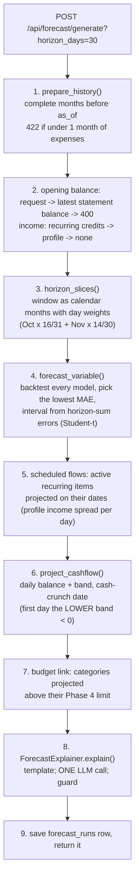

# Module: Financial Forecast Agent (Phase 5)

**Files:** `services/forecast_service.py`, `services/forecasting/` (`data_preparation.py`, `forecast_models.py`,
`backtest.py`, `variable_forecast.py`, `recurrence_detector.py`, `horizon.py`, `cashflow_projector.py`,
`metrics.py`), `agents/forecast_explainer.py`, `agents/explanation_guard.py` (shared with Phase 4),
`services/transaction_filters.py` (shared), `api/routes/forecast.py`, `schemas/forecast.py`, `models/forecast.py`,
`backend/migrations/versions/0004_forecast_runs.py`.
Design source: [../phase5-spec.md](../phase5-spec.md). Evaluation: [forecast-evaluation.md](forecast-evaluation.md).

## Purpose

"How much money will I have in 30, 60 or 90 days, and will I run short before then?" The agent forecasts
income, fixed bills, everyday (variable) spending, investments and a **daily balance** for the window, each
with an 80% range. It flags the first day the balance may go below zero (the *cash crunch*) and lists
Phase 4 budget categories that are heading over their limit.

Phases 6 (investments), 8 (goals) and 10 (coach) all need "how much will be left over", so they build on this.

## The idea in one picture: decomposition

A personal history is short (3 to 24 monthly values), so deep models (LSTM, Transformer) would overfit.
Instead the forecast is split into parts that are each easy to explain:

| Part | How it is forecast | Example |
|---|---|---|
| Recurring money | **Detected** in the history and placed on its exact future dates. Not predicted statistically | salary on the 1st, rent on the 5th, SIP on the 7th |
| Variable spending | A small statistical model, chosen **per user** by a backtest on that user's own months | groceries, food, shopping |
| Uncertainty | The chosen model's own past errors (a Student-t interval), so the range is honest | "₹48k–₹64k" |

`balance(day) = opening balance + scheduled credits − scheduled debits − variable spend per day × days so far`.

## Architecture: who does what

| Layer | File | Responsibility |
|---|---|---|
| Route | `api/routes/forecast.py` | HTTP only. `horizon_days` read as int, checked by the service (30/60/90, else 422) |
| Service | `services/forecast_service.py` | The 9-step flow below; saves a `forecast_runs` row |
| DB reader | `services/forecasting/data_preparation.py` | The **only** forecasting module that queries the DB: history span, recurring items, variable series, opening balance, income source |
| Pure maths | `forecast_models.py`, `backtest.py`, `variable_forecast.py`, `recurrence_detector.py`, `horizon.py`, `cashflow_projector.py`, `metrics.py` | No DB, no LLM, no HTTP. Plain floats; the service converts to exact `Decimal` before saving |
| Agent | `agents/forecast_explainer.py` | Explains the finished numbers. Template first, **one** LLM call, guard |
| Guard | `agents/explanation_guard.py` | Rejects LLM text that mentions a rupee amount that is not one of the forecast's numbers |
| Shared rules | `services/transaction_filters.py` | What counts as spending/income: the same SQL filters as the Budget agent |

Design rule (as in Phase 4): **Python computes, the LLM only explains.**

## Flow: generate a forecast



### The pieces, one sentence each

- **Recurrence detector** (`recurrence_detector.py`): a payee is monthly-recurring when it has at least 3
  payments, its regular payments are 25–35 days apart, the latest amounts stay within 15% of their median
  (at most one outlier, so a deposit to the landlord does not hide the rent), and, since F6.1, **all**
  payments to it are about monthly too (a grocery store paid 6 times a month is not a bill). Salary hikes
  are handled by using the latest 3 payments for the typical amount. Items not seen for 45 days are
  shown but not projected (`active=false`).
- **Variable series** (`data_preparation.py`): monthly expenses **minus** the regular payments of detected
  fixed bills, so rent is never counted twice. Investments (SIPs) are projected separately; refunds,
  redemptions and own-account transfers are neither income nor spending.
- **Models** (`forecast_models.py`): `naive_last` (B0), `moving_average_3` (B1), `seasonal_naive_12` (B2, needs
  12 months), `exp_smoothing` (B3). All share one signature, so the backtest compares them fairly.
- **Backtest** (`backtest.py`): "pretend it is month t, forecast month t+1, compare, move on". It never uses the
  future. The model needs at least `FORECAST_MIN_BACKTEST_FOLDS` folds to be chosen; otherwise the 3-month
  average is used and `low_confidence=true`.
- **Interval** (`backtest.py`): from the chosen model's backtest errors of the **same weighted window total**
  (not per-month quantiles added up, because monthly errors are correlated). Default method `student_t`:
  `mean error ± t(n−1) × sd × √(1 + 1/n)`, which widens honestly when there are few errors. With fewer than
  3 errors the fixed ±25% band is used and `low_confidence=true`.
- **Projector** (`cashflow_projector.py`): one point per day. The band widens linearly with elapsed days. The
  LOWER balance uses the UPPER spending estimate.

## Input

`POST /api/forecast/generate` query parameters:

| Parameter | Default | Meaning |
|---|---|---|
| `horizon_days` | 30 | 30, 60 or 90 (anything else → 422) |
| `opening_balance` | none | Your current balance. Empty → the latest running balance printed on an imported statement; none of those either → **400** |
| `as_of` | today (UTC) | Forecast as if today were this date (demo/evaluation). A future date → 422 |

Data it reads: your transactions up to `as_of` (with `txn_type`, `payee_key`, `category`, statement `balance`),
your Phase 4 financial profile (income fallback) and your Phase 4 budgets (warnings).

History rules: only **complete** months before `as_of` (the current partial month is excluded). Fewer than
1 month → 422; 1–2 months → moving average, fallback band, `low_confidence=true`; 3+ → backtest selection;
12+ → seasonal naive is eligible.

## Output

Example (synthetic panel user, high-spender persona, template explanation; lists shortened):

```json
{
 "id": 1, "as_of": "2026-02-15", "horizon_days": 30, "model_name": "naive_last", "history_months": 16,
 "low_confidence": false,
 "opening_balance": 58770.0, "opening_balance_source": "statement", "opening_balance_date": "2026-02-14",
 "income_source": "recurring",
 "expected_income": 87500.0, "expected_fixed_expenses": 29799.0,
 "expected_variable_expenses": {"point": 55375.99, "lower": 48469.26, "upper": 63926.9},
 "expected_investments": 0.0, "net_cashflow": 2325.01,
 "projected_end_balance": {"point": 61095.01, "lower": 52544.1, "upper": 68001.74},
 "cash_crunch_date": null, "cash_crunch_basis": "lower",
 "summary": "Over the next 30 days (until 17 Mar 2026) you can expect ₹87,500 of income from your regular credits, ₹29,799 of fixed bills, about ₹55,376 of everyday spending (likely between ₹48,469 and ₹63,927) ... Everyday spending is based on last month's spending, which had the smallest error on your past months.",
 "llm_used": false, "explanation_faithful": null,
 "model_scores": [{"model_name": "naive_last", "mae": 5768.92, "folds": 13},
                  {"model_name": "moving_average_3", "mae": 6789.31, "folds": 13}, "..."],
 "recurring_items": [{"key": "synth employer payroll", "kind": "income", "category": "Salary",
                      "typical_amount": 87500.0, "typical_day": 1, "occurrences": 17,
                      "last_seen": "2026-02-01", "active": true, "projected_dates": ["2026-03-01"]}, "..."],
 "budget_warnings": [],
 "trajectory": [{"date": "2026-02-16", "balance": 56817.04, "lower": 56532.01, "upper": 57047.26}, "...",
                {"date": "2026-03-17", "balance": 61095.01, "lower": 52544.1, "upper": 68001.74}]
}
```

How to read it: `net_cashflow = income − fixed − variable − investments` (point values), and the end balance
is `opening + net_cashflow`. `model_scores` shows *why* the model was chosen (the lowest backtest MAE).
A `budget_warnings` item looks like `{"month": "2026-03", "category": "Shopping", "projected": 9400.0,
"limit": 8000.0, "over_by": 1400.0}`: actual spending so far this month, plus the forecast for the rest of
the month × the category's share of the last 3 months, plus fixed bills still due.

## API

| Method | Path | Purpose |
|---|---|---|
| POST | `/api/forecast/generate?horizon_days=&opening_balance=&as_of=` | Build, explain and save a forecast |
| GET | `/api/forecast/latest?horizon_days=` | Your newest saved run (of one horizon, optionally); 404 if none |
| GET | `/api/forecast/history?limit=20` | Summary lines, newest first |
| GET | `/api/forecast/recurring?as_of=` | Detected recurring items with their dates in the next 30 days (read-only) |
| GET | `/api/forecast/runs/{id}` | One saved run; another user's id → 404 |

Details and errors: [../api.md](../api.md#forecast).

## LLM, guard and privacy

- **One** LLM call per forecast (the fallback provider only if the first fails). No key, or
  `FORECAST_USE_LLM_EXPLANATIONS=false` → the template, and everything still works (`llm_used=false`).
- The LLM receives only aggregate numbers, dates, model names, category names and recurring items **without
  their payee** (`ForecastFacts` has no field that could carry a description, payee, UPI ID or account).
- The guard checks every `₹ / Rs. / INR` amount in the text against all amounts in the response. An invented
  number → the template is shown and `explanation_faithful=false` is saved.

## Table (migration `0004`)

`forecast_runs`: one row per generated forecast with the headline numbers and their bands (all
`Numeric(14,2)`), sources, `low_confidence`, `cash_crunch_date`, the explanation and its flags, and JSON
columns `trajectory`, `recurring_items`, `budget_warnings`, `model_scores`. Columns: [../database.md](../database.md#forecast_runs).

## Configuration (`core/config.py`, override in `.env`)

| Setting | Default | Meaning |
|---|---|---|
| `FORECAST_INTERVAL_COVERAGE` | 0.8 | Target coverage of every interval |
| `FORECAST_INTERVAL_METHOD` | `student_t` | `student_t`, `empirical` (plain percentiles; too narrow, the pre-F6.1 rule) or `conformal` |
| `FORECAST_MIN_HISTORY_MONTHS` | 1 | Fewer complete months of expenses → 422 |
| `FORECAST_MIN_BACKTEST_FOLDS` | 2 | Folds needed before the backtest may choose a model |
| `FORECAST_MIN_INTERVAL_ERRORS` | 3 | Window-total errors needed for a residual interval; fewer → fallback band |
| `FORECAST_FALLBACK_INTERVAL_WIDTH` | 0.25 | Half-width of the fallback band (±25%) |
| `FORECAST_RECURRING_MIN_OCCURRENCES` | 3 | Payments needed before something is "recurring" |
| `FORECAST_RECURRING_AMOUNT_TOLERANCE` | 0.15 | How far a regular payment may be from the typical amount |
| `FORECAST_RECURRING_STALE_DAYS` | 45 | Not seen for this long → shown but not projected |
| `FORECAST_RECURRING_FREQUENCY_CHECK` | true | Require about-monthly payments across ALL payments to the payee (F6.1) |
| `FORECAST_USE_LLM_EXPLANATIONS` | true | `false` = template only |

## Testing

| File | Covers |
|---|---|
| `test_forecast_models.py`, `test_forecast_metrics.py` | the four models; MAE/RMSE/MAPE/sMAPE (zeros handled) |
| `test_forecast_backtest.py` | no peeking at the future, selection, min folds, horizon-sum errors, the three interval methods, Student-t quantiles |
| `test_recurrence_detector.py` | rent/salary detection, changing bills rejected, salary hike, one-off deposit tolerated, busy shop rejected (F6.1), projection dates |
| `test_forecast_horizon.py`, `test_forecast_variable.py`, `test_cashflow_projector.py` | month weights, fallback vs selection, trajectory, band, cash crunch |
| `test_forecast_data_preparation.py` | complete months only, rent not counted twice, investments separate, opening balance order, income source |
| `test_forecast_explainer.py` | template, one LLM call, guard replacement, provider fallback, privacy of the payload |
| `test_forecast_api.py` | every endpoint, user isolation (404), 422/400 cases, LLM down/unfaithful, clock injection |
| `test_synthetic_panel.py`, `test_forecast_evaluation.py` | the research panel and harness (see [forecast-evaluation.md](forecast-evaluation.md)) |

Live check: `docker compose exec backend python -m scripts.smoke_test` (steps 13–15: forecast without a
balance is 400, a 30-day forecast with a typed balance, then latest/history/recurring).

Manual check in Swagger: import a statement that has a balance column (or pass `opening_balance`), then
`POST /api/forecast/generate?horizon_days=60` → `GET /api/forecast/recurring` (does it list your salary and
rent?) → `GET /api/forecast/latest`.

## Common beginner mistakes

- Using a **random** train/test split for time series. The future leaks into the past; always split by time.
- Counting rent twice: once as a recurring bill and again inside the variable series.
- Including the current, half-finished month in the history (it looks like a month of low spending).
- Adding per-month interval quantiles to get a 3-month interval (monthly errors are correlated).
- Trusting an interval built from 3–5 errors with plain percentiles: it is far too narrow (47% coverage instead
  of 80% in our evaluation; see F6.1).
- Treating a SIP as spending, or a refund or self-transfer as income.
- Letting the LLM adjust a number. It only explains; the guard enforces it.

## Known limitations

- **Income is treated as known.** The band only covers variable spending. For a freelancer with lumpy
  invoices the net cash-flow error is large (30-day MAE ≈ ₹49k) and the band covers it 15% of the time
  (see the evaluation).
- Intervals are still below their 80% target (≈ 61–65% on the synthetic panel, after F6.1).
- Backtest selection does not beat the best single fixed model on our synthetic panel (small positive regret).
- Own-account transfers (top-ups from savings, sweeps) are not forecast.
- Daily spending is spread evenly over the month (no weekday or payday pattern).

## What it connects to next

- **F8 (optional):** `GET /api/forecast/accuracy` compares saved runs with what really happened.
- **F10 (frontend):** `/forecast` page: horizon toggle, balance chart with the band, cards, crunch banner.
- **Phases 6/8/10:** investable surplus, goal feasibility and coaching all read `net_cashflow` and the end balance.
