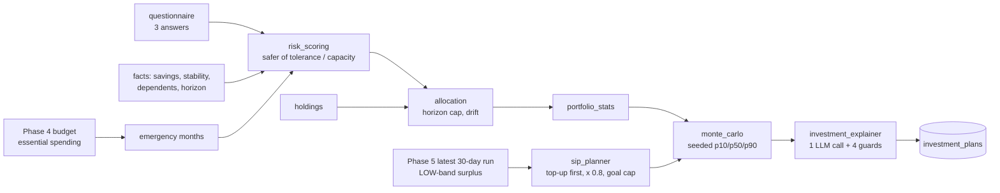

# Module: Investment Advisor Agent (Phase 6)

**Files:** `services/investing/` (pure modules), `services/investment_service.py`, `agents/investment_explainer.py`,
`agents/explanation_guard.py` (shared), `api/routes/investing.py`, `models/investment.py`, `schemas/investment.py`,
`core/disclaimers.py`, migration `0005_investing.py`. Design: [../phase6-spec.md](../phase6-spec.md) (section 14 holds
the decisions taken after the code audit). Results: [investing-evaluation.md](investing-evaluation.md).

**This is an educational planning tool, not financial advice.** Every response carries a `disclaimer`.

## Purpose

Answer four questions for one user, from their own data only:

1. **How much risk?** A risk profile from a questionnaire (tolerance) AND from their finances (capacity). The safer wins.
2. **How to split the money?** A target split over equity, debt, gold and cash, capped for short horizons, compared
   with what they hold (rebalancing rows).
3. **How much can I invest a month?** A SIP sized from the LOWER band of the Phase 5 forecast surplus, after an
   emergency-fund top-up, and never more than a goal needs.
4. **What might happen?** A seeded Monte Carlo range (p10 / p50 / p90) and the chance of reaching a goal, under
   assumptions the user can see.

Not in Phase 6: named funds or stocks (Phase 7), portfolio optimisation (future work), broker integration
(holdings are typed in by hand).

## The idea in one picture



## Architecture: who does what

| Layer | File | Job |
|---|---|---|
| Route | `api/routes/investing.py` | HTTP only. JWT on every route, `user_id` from the token |
| Service | `services/investment_service.py` | Orchestration: reads the DB, the forecast and the budget, calls the pure modules in order, stores the plan. No formulas of its own |
| Pure maths | `services/investing/risk_scoring.py`, `allocation.py`, `portfolio_stats.py`, `sip_planner.py`, `monte_carlo.py` | All the maths. No DB, no LLM, no app imports (except each other) |
| Pure checks | `services/investing/claims_guard.py` | "guaranteed", "risk-free", "can't lose" (also with a curly apostrophe) |
| Data | `services/investing/instrument_catalog.py`, `assumptions.py` | Instrument TYPES per class; return / volatility assumptions from the `INVEST_*` settings |
| Agent | `agents/investment_explainer.py` | Pre-formats the facts, one LLM call, runs the guards, template fallback, appends the disclaimer |
| Helpers in other services | `forecast_service.latest_run_row`, `budget_service.average_essential_spending` | Read the latest run (or None) and the month's essential spending |

`claims_guard` lives with the pure investing modules, and agents must not import services, so the service
passes `find_prohibited_claims` into the explainer when it builds it (dependency injection).

## Flow: generate a plan (`POST /api/investing/plan`)

1. **Profile** (409 if missing) and **holdings** (missing = empty, warning `no_holdings`).
2. **Essentials:** `average_essential_spending(month of as_of)`. If the month has essential budget limits, their sum
   (user overrides count); otherwise the essential categories of the last 3 months of history; otherwise unknown
   (warning `essentials_unknown`, emergency fund treated as 0 months: fail safe).
3. **Emergency months** = liquid savings / essentials (2 decimals). **Gap** = 6 months of essentials - savings.
4. **Risk profile:** `build_risk_profile` (tolerance = mean answer rescaled to 0-100; capacity = mean of emergency,
   stability, dependents and horizon parts, capped at 40 under 3 months of emergency fund). The safer category wins;
   `limiting_factor` says which side limited it.
5. **Allocation:** horizon = `goal_years` if given, else the profile horizon. `target_allocation` caps equity for
   short horizons (excess to debt, or cash under 1 year). `rebalance_actions` flags classes more than 5 points off.
6. **Surplus:** the latest **30-day** run (one month: the SIP must be affordable every month):
   `(expected_income - expected_fixed_expenses - expected_variable_expenses_upper) x 30.44 / horizon_days`.
   The UPPER spending band gives the LOW surplus. Older than 31 days → `forecast_stale`. No run → income minus the
   month's budgets with `forecast_missing`; neither → 0 with `surplus_unknown` (never a silent guess).
7. **SIP:** `recommend_sip`: top-up = gap / 12; capacity = low surplus x 0.8 - top-up; with a goal, capped at the
   `required_sip` at the expected return (`limited_by: "target"`).
8. **Projections:** `simulate_sip` at the existing and the recommended SIP (2,000 paths, seed 42), and
   `months_to_reach` the goal for both.
9. **Explanation** (below), then one `investment_plans` row with inputs, results, assumptions and the research log.

## Input

| From | What |
|---|---|
| `PUT /profile` | 3 answers (1-5), liquid savings, existing monthly SIP, income stability (1-5), dependents, horizon years |
| `PUT /holdings` | rupees per asset class, optional label |
| `POST /plan` | optional `goal_amount`, `goal_years` |
| Phase 5 | the latest 30-day forecast run |
| Phase 4 | the month's essential budget limits (or history) and, as a fallback, profile income minus budgets |
| Settings | `INVEST_*` assumptions (below) |

## Output (abridged `InvestmentPlanResponse`)

A real plan from the live smoke test (synthetic user, goal ₹5,00,000 in 5 years, holdings 80% equity):

```json
{"risk_profile": {"tolerance_score": 58.3, "capacity_score": 88.8, "tolerance_category": "moderate",
                  "capacity_category": "aggressive", "category": "moderate", "limiting_factor": "tolerance"},
 "target_allocation": {"equity": 0.55, "debt": 0.3, "gold": 0.1, "cash": 0.05},
 "rebalance": [{"asset_class": "equity", "current_weight": 0.8, "target_weight": 0.55, "amount_change": -25000.0, "action": "reduce"}],
 "sip": {"capacity_total": 29426.14, "recommended_total": 6735.17, "change_vs_existing": 3735.17, "emergency_topup": 0.0, "limited_by": "target"},
 "projection_recommended": {"p10": 420911.66, "p50": 496189.63, "p90": 582680.36, "probability_of_goal": 0.4745, "months_to_goal": 61},
 "surplus": {"monthly_low": 36782.68, "source": "forecast", "forecast_as_of": "2026-10-23"}, "warnings": [],
 "explanation": "... These are scenarios under assumed returns ...\n\nEducational planning tool, not financial advice. ...",
 "explanation_source": "llm", "disclaimer": "Educational planning tool, not financial advice. ..."}
```

## API

All under `/api/investing`, JWT required: `PUT|GET /profile`, `PUT|GET /holdings`, `POST /plan`, `GET /plan/latest`,
`GET /plans`, `GET /plans/{plan_id}`, `POST /simulate` (what-if, not stored, paths fixed by settings), `GET /assumptions`. Details and
validation rules: [../api.md](../api.md#investing).

## LLM, guards and privacy

- **One call** per plan (the provider fallback chain may make more only after a provider error).
- **Facts are pre-formatted** (`build_facts`): rupees as whole amounts with Indian digit grouping (`₹12,34,567`),
  shares as `55%`. The model is told to copy them exactly. Raw floats never reach the model.
- **Four checks** on the answer; any failure → the template:
  1. every rupee amount must be in the facts (₹1 tolerance; `is_faithful` reads Indian grouping correctly);
  2. every percentage must be in the facts (1 percentage point);
  3. no lakh / crore / `k` / `L` amounts (the rupee pattern would read "₹12.5 lakh" as ₹12.5);
  4. no prohibited claims (`claims_guard`), even negated ones ("not guaranteed"): deliberate, fail safe.
- The **disclaimer is appended by code after the guards** (it says "not guarantees", which the claims guard would
  flag; a test shows an LLM copying it is rejected).
- **Research log** on every plan: `llm_used`, `explanation_faithful`, `claims_compliant`, `llm_calls`,
  `raw_prohibited_claims` (counted in the RAW text). `explanation_source` is derived.
- **Privacy:** only aggregates, categories, asset classes and instrument types are sent; never holding labels or
  transactions (tested). Synthetic data only with the free Gemini tier.

## Tables (migration `0005`)

`investment_profiles` (one per user), `holdings` (CHECK on the asset class and amount, UNIQUE
`(user_id, asset_class, label)` with a NOT NULL label), `investment_plans` (index `(user_id, created_at DESC)`).
Columns: [../database.md](../database.md#investment_profiles).

## Configuration (`core/config.py`, override in `.env`)

| Setting | Default | Meaning |
|---|---|---|
| `INVEST_{EQUITY,DEBT,GOLD,CASH}_RETURN` | 0.11 / 0.06 / 0.07 / 0.035 | annual expected return. **Illustrative placeholders, to be cited before publication** |
| `INVEST_{EQUITY,DEBT,GOLD,CASH}_VOL` | 0.17 / 0.04 / 0.14 / 0.005 | annual volatility (placeholders) |
| `INVEST_SIP_SAFETY_FACTOR` | 0.8 | share of the low-band surplus the SIP may use |
| `INVEST_MC_PATHS`, `INVEST_MC_SEED` | 2000, 42 | Monte Carlo paths and seed |
| `INVEST_EMERGENCY_TARGET_MONTHS` | 6 | the top-up fills the fund to this many months |
| `INVEST_EMERGENCY_FILL_MONTHS` | 12 | ... over this many months |
| `INVEST_FORECAST_MAX_AGE_DAYS` | 31 | older 30-day runs give `forecast_stale` |
| `INVEST_USE_LLM_EXPLANATIONS` | true | false = template only (ablation) |

Bounds are validated at startup, so a typo in `.env` fails loudly.

## Testing

```powershell
docker compose exec backend python -m pytest tests -q -k "investing or investment or risk_scoring or allocation or portfolio_stats or sip_planner or monte_carlo or claims_guard"
docker compose exec backend python -m scripts.smoke_test       # step 16: profile, holdings, plan, simulate
```

The forecast is "stubbed" in tests by saving a `forecast_runs` row (`tests/conftest.py:add_forecast_run`), because
the service only reads saved runs. File-by-file coverage: [../testing.md](../testing.md).

## Common beginner mistakes

- Putting maths in the prompt. The model rounds and invents; Python computes, the model narrates.
- Sizing the SIP from the average surplus: one bad month breaks the plan.
- Recommending equity to someone with no emergency fund because the questionnaire says "brave".
- Money in `Float` or in JSON. Use `Numeric(14,2)` columns.
- A nullable column in a UNIQUE constraint (NULLs never collide, so duplicates slip in).
- Sending raw floats to the LLM (it writes "₹12.3 lakh" and the guard rejects it).
- Counting prohibited claims AFTER the template replaced the text (always 0).
- Overriding the auth dependency in every test, so "is login required?" is never tested.
- Letting the client choose the Monte Carlo path count.

## Known limitations

- Return assumptions are placeholders; normal monthly returns understate fat tails; no tax, fees or inflation.
- Income has no band in Phase 5, so for irregular earners the low surplus is optimistic; on the replayed panel the
  SIP still exceeds the actual next-month surplus in about 28% of forecasts (see the evaluation).
- With a goal, the SIP is sized at the expected return, which gives roughly a 50% chance of reaching it by
  construction (ablation `goal_p75` in the evaluation).
- Unknown essentials cap capacity but no top-up can be sized (the gap needs a monthly essential figure).
- The budget fallback surplus (no forecast) is an average, not a lower band.
- Plain numbers without ₹ or % (years, months) are not checked in LLM text; the claims guard misses promises worded
  without its trigger words.

## What it connects to next

Phase 7 (Stock Intelligence) plugs in as an optional "satellite" slice and supplies real index history for a
bootstrap Monte Carlo (normal vs historical). Phase 8 (Goal Planning) reuses `required_sip`, `months_to_reach` and
`simulate_sip`. Phase 6C adds the `/investing` page of the frontend.
