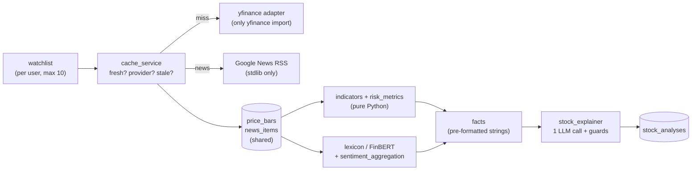

# Module: Stock Intelligence Agent (Phase 7)

**Files:** `services/stocks/` (pure modules), `market_data/` (provider adapters, cache, fallback chain), `sentiment/`
(lexicon and FinBERT scorers), `services/stock_service.py`, `agents/stock_explainer.py`, `agents/explanation_guard.py`
(shared), `services/investing/claims_guard.py` (stock guard v3.1), `api/routes/stocks.py`, `models/stock.py`,
`schemas/stock.py`, `core/stock_symbols.py`, migration `0006_stocks.py`, `scripts/seed_market_cache.py`.
Design: [../phase7-spec.md](../phase7-spec.md). Provider choice: [../phase7-provider-spike.md](../phase7-provider-spike.md).
Results: [stocks-evaluation.md](stocks-evaluation.md).

**This is an educational analysis tool, not financial advice. Past data does not predict future prices.** Every
response carries that `disclaimer`. The agent describes the past and the news; it never says buy, sell or hold, and
never says what a price will do.

## Purpose

For each stock on a user's watchlist, a plain-language **analysis snapshot** built from facts:

1. **Trend and momentum:** last close against the 50- and 200-day averages, 14-day RSI with its convention label.
2. **Risk over the last 252 trading days:** annualised volatility, largest fall from a peak, one-day 95% historical
   VaR, beta and correlation against the Nifty 50 (`^NSEI`).
3. **News sentiment:** up to 30 recent headlines scored by the lexicon (default) or FinBERT, combined with a 3-day
   half-life, marked "not reliable" under 3 headlines.
4. **Data freshness:** where the prices came from, `data_as_of`, and a warning when the data is stale.
5. **An explanation:** one LLM call from pre-formatted facts, checked by guards, with a template fallback.

It keeps working when the data source does not (cache, stale fallback, CSV upload), which is what makes the live demo safe.

## The idea in one picture



## Architecture: who does what

| Layer | File | Job |
|---|---|---|
| Route | `api/routes/stocks.py` | HTTP only. JWT on every route; `{symbol}` validated by a path dependency (422) |
| Service | `services/stock_service.py` | Watchlist, refresh, chart prices, CSV upload, analysis orchestration, status. No formulas |
| Market data | `market_data/base.py`, `yfinance_provider.py`, `rss_news_provider.py`, `factory.py` | Provider protocol, adapters (timeouts, at most 2 retries, `ProviderError` kinds), chosen by `MARKET_DATA_PROVIDER` / `NEWS_PROVIDER` |
| Cache | `market_data/cache_service.py` | Fallback chain, upserts, `provider_calls` log, cooldown with backoff |
| Pure maths | `services/stocks/indicators.py`, `risk_metrics.py`, `sentiment_aggregation.py`, `walk_forward.py`, `bootstrap_returns.py` | All the numbers. No DB, no network, no LLM |
| Sentiment | `sentiment/lexicon_scorer.py`, `finbert_scorer.py`, `factory.py` | Same `(positive, negative, neutral)` shape; FinBERT loads lazily and falls back to the lexicon |
| Agent | `agents/stock_explainer.py` | Pre-formatted facts, one LLM call, guards, template, disclaimer |
| Checks | `agents/explanation_guard.py`, `services/investing/claims_guard.py` | Any-number guard, lakh/crore shorthand guard, claims guard v3.1 (advice, predictions, promises) |
| Symbols | `core/stock_symbols.py` | Strict validator before a symbol reaches a URL or a query |

Vendor rule: `yfinance` is imported in exactly one file (`market_data/yfinance_provider.py`), lazily. It is outside
the original approved stack and was approved on 2026-11-09 for the data-provider adapter only.

## The fallback chain (`cache_service.get_prices`)

1. **Fresh cache:** the provider fetched this symbol within `STOCK_CACHE_TTL_HOURS` AND after the latest 16:00 IST
   weekday close (so the cache has that close). CSV-uploaded rows never count as fresh.
2. **Provider:** the full `STOCK_HISTORY_DAYS` window, upserted on `(symbol, bar_date)`. Every real call is logged
   in `provider_calls`. An empty answer counts as `not_found`.
3. **Stale cache:** any cached rows, with the warning `data_stale` (and `provider_error` = the failure kind).
4. **Nothing at all:** `NoMarketDataError` (HTTP 503) whose message points to `POST /{symbol}/prices/upload`.

**Cooldown (engine 7.1):** after a `rate_limited` or `unavailable` call the provider is left alone and the stale
cache is served straight away. The wait is 15 minutes after one failure and doubles with each failure in a row, up to
`STOCK_PROVIDER_COOLDOWN_MAX_MINUTES` (240). Engine 7.0 used a constant 15 minutes; the Phase 7B simulation showed that
still spent about 58 failed calls per 100 requests during a long outage (see the evaluation). `not_found` does not
cool the provider down (it is about one symbol, not the provider).

Headlines follow the same chain (`get_news`), except that "nothing cached" gives the warning `news_unavailable`
instead of an error: an analysis without news is still useful.

## Flow: generate an analysis (`POST /api/stocks/{symbol}/analysis`)

1. The symbol must be on the user's watchlist (404 otherwise): the limit then really protects the free quota.
2. Prices through the chain (400 calendar days). Fewer than 252 bars → warning `insufficient_history` and every
   indicator that needs more history is `null`, never a crash (tested for 1 to 300 bars).
3. Benchmark bars the same way (`benchmark_unavailable` / `benchmark_stale`); beta and correlation use returns
   aligned by date. An index is not compared with itself.
4. Indicators (`compute_indicators`), then headlines, scored by the active scorer (scores written back to
   `news_items`) and aggregated (`few_headlines` under 3).
5. The explainer (below), then one `stock_analyses` row with the inputs, the full result, `data_as_of`, the sources,
   the warnings, `engine_version` (`7.1`) and the research fields.

## Output (abridged `StockAnalysisResponse`)

A real analysis from the live smoke test (engine 7.0 row, 2026-11-09):

```json
{"symbol": "RELIANCE.NS", "data_as_of": "2026-11-06", "warnings": [],
 "indicators": {"bars_used": 270, "last_close": 1320.0, "sma_50": 1235.59, "sma_200": 1325.383,
                "trend": "between_averages", "rsi_14": 68.19, "rsi_label": "normal", "annualized_volatility": 0.2417,
                "max_drawdown": -0.2728, "var_95_one_day": 0.0222, "change_1m": 0.093, "change_1y": -0.1132,
                "beta": 0.97, "correlation": 0.5697, "benchmark": "^NSEI"},
 "sentiment": {"score": 0.2628, "label": "positive", "n_items": 30, "reliable": true, "scorer": "lexicon"},
 "sources": {"prices": "yfinance", "prices_cache": "fresh", "news": "google_rss", "sentiment_scorer": "lexicon"},
 "explanation": "RELIANCE.NS closed at ₹1,320.00 as of 2026-11-06 ... beta of 0.97 relative to the Nifty 50 (^NSEI).\n\nEducational analysis tool, not financial advice. Past data does not predict future prices.",
 "explanation_source": "llm", "disclaimer": "Educational analysis tool, not financial advice. ..."}
```

## API

All under `/api/stocks`, JWT required (12 routes): `GET|POST /watchlist`, `DELETE /watchlist/{symbol}`,
`POST /{symbol}/refresh`, `GET /{symbol}/prices?days=` (cache only, with SMA 50/200), `POST /{symbol}/prices/upload`
(CSV fallback), `POST /{symbol}/analysis`, `GET /{symbol}/analysis/latest`, `GET /{symbol}/analyses`,
`GET /{symbol}/analyses/{id}`, `POST /sentiment/score`, `GET /status`. Details: [../api.md](../api.md#stocks).

## LLM, guards and privacy

- **One call** per analysis (the provider fallback chain may make more only after a provider error).
- **Facts are pre-formatted strings** (`build_facts`): `₹1,320.00` (or "points" for an index), `+9.3%`, `0.97`.
  Missing values are `null` and the prompt says to leave them out.
- **Checks on the answer; any failure → the template:**
  1. **any-number guard:** every number in the text must appear in the facts (stricter than Phase 4-6, which only
     checked ₹ and %);
  2. no lakh / crore / `k` shorthand;
  3. **claims guard v3.1:** advice ("you should buy", "stay invested", "consider trimming"), predictions ("will
     rise", "a correction is coming", "price target") and Phase 6 promises ("guaranteed"), except inside a
     disclaiming frame ("nobody can say whether ...", "does not mean the price will fall").
- **Headlines are never sent to the LLM**, only the aggregate (a headline is untrusted text: prompt injection).
- The **disclaimer is appended by code** after the guards.
- **Research log** on every analysis: `llm_used`, `explanation_faithful`, `claims_compliant`, `llm_calls`,
  `raw_prohibited_claims` (counted in the raw text); `explanation_source` is derived.
- Only public market aggregates go to the LLM; no user data is involved.

## Sentiment scorers

| Scorer | When | Notes |
|---|---|---|
| `lexicon` (default) | always available | Small word list with a negation flip; also the paper's baseline |
| `finbert` | `SENTIMENT_SCORER=finbert` in the `ml` profile | `ProsusAI/finbert` at a pinned revision, safetensors only, CPU, loaded lazily on first use (about 12-26 s cold, 4 s from the volume). Model card licence CC BY-NC-SA 4.0 (non-commercial; academic use with attribution). If it cannot load, the lexicon is used with the warning `finbert_unavailable` |

Phase 7B result: FinBERT beats the lexicon on financial news tweets (macro-F1 +0.09), and a TF-IDF + logistic
regression trained on in-domain data beats both (see the evaluation).

## Tables (migration `0006`)

`watchlist_items` (per user, UNIQUE `(user_id, symbol)`), `price_bars` and `news_items` (shared public market data:
UNIQUE `(symbol, bar_date)` / `(symbol, url)`, `Numeric(14,4)` prices with CHECK constraints), `stock_analyses`
(per user, index `(user_id, created_at DESC)`), `provider_calls` (provider, endpoint, status, at).
Columns: [../database.md](../database.md#stocks-migration-0006).

## Configuration (`core/config.py`, override in `.env`)

| Setting | Default | Meaning |
|---|---|---|
| `MARKET_DATA_PROVIDER` | yfinance | the price adapter (the only one the spike approved) |
| `NEWS_PROVIDER` | google_rss | headlines: `google_rss` or `yfinance` |
| `STOCK_CACHE_TTL_HOURS` | 24 | how long fetched prices count as fresh (also needs the latest close) |
| `STOCK_WATCHLIST_LIMIT` | 10 | symbols per user (protects the free quota) |
| `STOCK_HISTORY_DAYS` | 3650 | calendar days fetched per refresh |
| `STOCK_BENCHMARK_SYMBOL` | ^NSEI | benchmark for beta and the seed script |
| `STOCK_PROVIDER_COOLDOWN_MINUTES` | 15 | cooldown after one rate limit / outage (0 = off) |
| `STOCK_PROVIDER_COOLDOWN_MAX_MINUTES` | 240 | backoff cap (engine 7.1); equal to the line above = constant cooldown |
| `STOCK_USE_LLM_EXPLANATIONS` | true | false = template only (ablation; also needed offline, see limitations) |
| `SENTIMENT_SCORER` | lexicon | `lexicon` or `finbert` |
| `FINBERT_MODEL_NAME`, `FINBERT_MODEL_REVISION`, `FINBERT_BATCH_SIZE` | ProsusAI/finbert, pinned hash, 16 | FinBERT settings |

## Running it

```powershell
docker compose exec backend python -m scripts.seed_market_cache        # once, while online (3 stocks + ^NSEI)
docker compose exec backend python -m scripts.seed_market_cache --symbols INFY.NS ITC.NS   # more symbols
docker compose --profile ml up                                         # optional FinBERT backend on port 8001
```

## Testing

```powershell
docker compose exec backend python -m pytest tests -q -k "stock or market or sentiment or indicators or risk_metrics or walk_forward or bootstrap"
docker compose exec backend python -m scripts.smoke_test       # step 17 works from the seeded cache, also offline
```

No test touches the network: providers are faked (`tests/market_fakes.py`), fixtures are small synthetic files, and
the real FinBERT test is skipped unless the model is installed and cached. File-by-file coverage:
[../testing.md](../testing.md).

## Common beginner mistakes

- Calling the live API inside tests (slow, flaky, eats the quota).
- Not caching: a small daily limit disappears in minutes of testing.
- Committing API keys or downloaded price data (the repo has neither; the evaluation stores SHA-256 hashes only).
- Shuffling time series before splitting, or fitting a scaler on all the data: the model "sees the future".
- Calling a 53% hit rate "a good model" without a significance test and a buy-and-hold baseline.
- Mixing adjusted and unadjusted prices (fake jumps at splits).
- Trusting one headline: always show how many headlines the sentiment is based on.
- Building URLs from raw user text: validate the symbol first.
- Loading FinBERT at app start (slow startup, heavy packages): load it lazily and optionally.
- Believing a regex guard is complete: on new sentences, v3.1 still caught only 1 in 5 advice or prediction
  sentences (the template fallback and the deliberately narrow facts are what keep the output safe).

## Known limitations

- yfinance is an unofficial route: it can change or rate-limit without notice; data is daily and may be delayed.
- Cached prices are shared by all users, and uploaded CSV bars are visible to everyone (insert-only).
- News search by ticker code has no relevance filter; free RSS returns about 30 recent headlines, so there is no
  usable headline history (RQ2 in the evaluation could not be tested).
- Offline, the Phase 4-6 LLM explanation calls hang until their timeout; the offline smoke run needs the
  `*_USE_LLM_EXPLANATIONS=false` switches. Gemini sometimes returns truncated JSON (the template is used).
- The claims guard is a regex: it misses advice worded without its trigger phrases and negated predictions
  ("the price will not fall"). Holidays are not modelled in the freshness rule.
- FinBERT was trained on English financial text and on Financial PhraseBank; Indian regional-language news is not covered.

## What it connects to next

Phase 7C adds the `/stocks` page of the frontend. Phase 7D adds `method="bootstrap"` to `POST /api/investing/simulate`
(block bootstrap of cached Nifty 50 monthly returns; the evaluation's RQ4 compares it with the normal method).
Phase 9 (Automation) moves the daily refresh and headline collection to a Celery schedule, which would also build the
headline history RQ2 needs.
